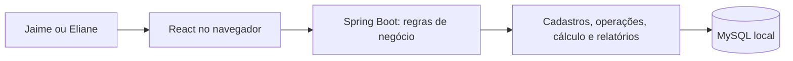

# Arquitetura e registro de decisões

## Base confirmada e propostas

**Confirmado:** MySQL, Spring Boot, Java 21+, Flyway, MockMvc, React/Vite/TypeScript e um repositório único. Sem H2 nesta etapa: testes de domínio sem banco e integração de persistência com MySQL/Testcontainers. Docker está disponível; o MySQL já instalado será usado no desenvolvimento. Login mockado por serviço no frontend. Autenticação real será responsabilidade de um backend externo; o backend de negócio não controla usuários ou sessões. A estrutura interna do backend será discutida antes da próxima expansão.

**Build confirmado em 01/11/2026:** Gradle com wrapper, por preferência de Jaime, substituindo a proposta anterior de Maven. Usar Groovy DSL (`build.gradle` e `settings.gradle`) como padrão inicial; isso não altera a linguagem Java do backend.

**Base implementada:** Java 27 e Spring Boot 4.2.0-SNAPSHOT por alteração de Jaime; Spring MVC/JPA e frontend integrado para uso local. Gradle Wrapper 9.8.2. Novas camadas continuam condicionadas a responsabilidades concretas.

Baseline efetivamente usada e tarefas de comprovação: [marco 1 detalhado](05-marco-1.md). A estrutura Spring Boot/Gradle e React já passou por testes e build locais. A CI remota foi [executada com sucesso](https://github.com/jaimeNafer/mvp-invest/actions/runs/41355920250) no PR #11.

## Estrutura alvo

```text
mvp-invest/
  backend/       API de negócio, domínio, persistência e migrations
  frontend/      React, TypeScript e Vite
  docs/          Escopo, arquitetura, entregas e validação
  prototype/     Código e imagens da referência aprovada
```

Esta estrutura já foi criada no marco 1. O protótipo segue executável, com seus testes e imagens em `prototype/`.



## Decisões arquiteturais

| ID e estado | Escolha e motivo | Consequência |
| --- | --- | --- |
| ARQ-01 — confirmada | Monorepositório, com frontend e backend separados por diretórios. | Mudanças de uma funcionalidade podem ser revisadas juntas; builds continuam independentes. |
| ARQ-02 — adotada em 02/11/2026 | Um backend modular por funcionalidade, com domínio financeiro separado de controllers e entidades de transporte. | Implantação simples e testes do cálculo sem depender de HTTP; evitar microserviços, filas e infraestrutura adicional neste estágio. |
| ARQ-03 — decisão vigente de 01/11/2026 | Autenticação real será externa. Hoje o frontend valida Jaime/Eliane mockados; por novo pedido, o backend lê o Bearer para identificar a requisição. | Sem cadastro de usuários, senhas, emissão de tokens ou sessões no backend de negócio. Filter/contexto centralizam identificação, com validação real a integrar depois. |
| ARQ-04 — confirmada | Fatos preservados, correções por substituição e cancelamento auditável. | Recalcular projeções; não corrigir saldo diretamente nem expor exclusão física de operações confirmadas. |
| ARQ-05 — confirmada em 01/11/2026 | Um motor financeiro no backend Java com BigDecimal, inclusive para as prévias; transporte decimal como strings para preservar valores no frontend. | React apresenta os resultados do backend e não mantém um segundo motor financeiro. Política de precisão/arredondamento permanece em revisão separada. |
| ARQ-06 — proposta | Flyway como único mecanismo de alteração do schema; JPA valida o mapeamento. | Não usar atualização automática do schema pelo Hibernate; validar migrations no MySQL. |
| ARQ-07 — confirmada em 01/11/2026 | MySQL/Testcontainers para integração de persistência e domínio sem banco; não incluir H2 nesta etapa. | Docker é necessário para a suíte de integração; não manter dependência, perfil ou schema H2. Reavaliar somente se surgir uma necessidade concreta. |
| ARQ-08 — proposta revisada | Recalcular sincronamente o histórico do usuário, com operações vinculadas ao usuário/instituição e regras detalhadas antes do motor. | Carteiras selecionam a visualização e não criam livros independentes. Medir até 5.000 operações antes de otimizar. |
| ARQ-09 — confirmada em 01/11/2026 | Quantidade/preço/câmbio até 18 casas; BRL persistido até 8 casas e exibido com 2; HALF_EVEN e política versionada. | Não reduzir intermediários a centavos ou truncar entradas inválidas. Fronteiras de arredondamento e precisão de divisão serão especificadas e testadas antes do motor. |
| ARQ-10 — confirmada em 01/11/2026 | Gradle com wrapper no backend, por preferência de Jaime. | Versionar scripts e arquivos do wrapper; build local e CI usam a mesma distribuição. Não criar POM ou exigir Maven/Gradle global. |
| ARQ-11 — confirmada em 01/11/2026 | Spring Data JPA para os cadastros, conforme escolha de Jaime. | API, casos de uso transacionais, contratos de domínio e adapters Spring Data, com modelos JPA. `@EntityGraph` carrega somente relações internas; metadados externos vêm de contratos públicos em lote; sem exclusão em cascata. |
| ARQ-12 — substituída em 02/11/2026 | A decisão anterior de titulares independentes de espaços foi substituída por carteiras e contas do usuário. | V5 removeu espaços; V8 remove titulares e recria contas, exigindo cadastros vazios e backup. V1–V7 são imutáveis. [Modelo vigente](10-modelagem-de-carteiras.md). |
| ARQ-13 — esclarecimento final de 02/11/2026 | `contas` é associação N:N entre carteira e instituição. Carteiras com Binance mostram as mesmas operações do usuário. | IDs de vínculo não são proprietários dos lançamentos. Operações futuras têm usuário/instituição e existência independente das carteiras; consultas combinadas não duplicam operações. |
| ARQ-14 — confirmada em 01/11/2026 | Filter lê o Bearer e carrega `IUsuarioAtual` com ID, nome e role, em escopo de requisição. Services recebem o contexto pelo construtor. | Controllers/frontend não passam perfil; sem estado global ou ThreadLocal manual. Leitura do JWT sem assinatura permanece mockada, com 401 para token ausente/malformado e sem autenticar credenciais. |

## Padrão arquitetural obrigatório — decisão de 02/11/2026

Adotar organização por contexto (`carteiras`, `ativos`, `instituicoes`, `operacoes`). Não criar camadas globais que misturem os assuntos. Usar os seguintes subpacotes somente quando houver conteúdo:

```text
contexto/
  domain/
    model/          entidades, objetos e resultados internos
    repository/     interfaces específicas de persistência
    service/        cálculos e regras independentes de HTTP
    exception/      exceções especializadas de negócio
  application/
    contract/       API pública entre contextos, somente quando necessária
    usecase/        contratos internos das capacidades HTTP
      impl/         coordenação e transações
    dto/            entradas, saídas e resultados de aplicação
    mapper/         transformação manual de dados
  infrastructure/
    persistence/    Spring Data, consultas e adapters
    clients/        futuras implementações de integração externa
  api/
    controller/     binding, validação estrutural, delegação e HTTP
```

### Direção das dependências

`api → application → domain`; `infrastructure → domain`. Domínio não importa aplicação, API, infraestrutura ou Spring. Exceção consciente: modelos usam Jakarta Persistence/JPA, Lombok e tipos de mapeamento Hibernate necessários ao schema existente. Não duplicar entidades para obter isolamento completo nesta etapa.

Controllers injetam interfaces de casos de uso e não conhecem entidades, repositories ou mappers. Casos de uso retornam DTOs já mapeados, dentro da transação, e injetam interfaces de repositories, acesso e demais capacidades. Helpers puros de validação/mapeamento não precisam de interfaces artificiais. Não criar uma camada `services` paralela aos usecases de aplicação.

Interfaces Spring Data ficam somente em `infrastructure.persistence`. Interfaces de domínio não estendem JpaRepository e não expõem Page, Pageable ou Specification; o adapter traduz filtros e paginação próprios. Exemplo: `FiltroOperacoes` e `PaginaOperacoes`. Repositories e entidades são internos ao contexto, inclusive suas interfaces de domínio. Acesso externo ocorre somente pelo pacote exato application.contract, com snapshots escalares e matriz explícita. Associações JPA são permitidas dentro do contexto; referências a outros contextos usam IDs, preservando as FKs SQL. [Auditoria, matriz e contratos](13-auditoria-modular.md).

### Responsabilidades e exemplos

- `Conta` está em `carteiras.domain.model`: vínculo administrado pela carteira, sem histórico financeiro próprio.
- `CarteiraUseCaseImpl` coordena cadastro/edição; `CarteiraMapper` produz responses sem expor perfil, timestamps internos ou entidades.
- `SaldoInicialUseCaseImpl` mantém a transação; `ValidacaoSaldoInicial` normaliza/valida e `IdentidadeSolicitacaoSaldo` trata chave/fingerprint. `CalculoPosicaoInicial`, em domain.service, usa BigDecimal sem HTTP/persistência.
- `PontoPartidaPersistenceAdapter` insere explicitamente via EntityManager.persist/flush. Atribuir manualmente o ID não pode provocar merge e sobrescrever a data concorrente. READ_COMMITTED, bloqueio pessimista e flush anterior à substituição continuam obrigatórios.
- Cada classe, interface, record ou enum de produção ocupa arquivo próprio, sem tipos aninhados. Métodos de validação devem nomear a regra; evitar condições compostas espalhadas e decomposição de operações triviais.
- Futuros clients implementam interfaces da aplicação consumidora. Não criar clientes, interfaces genéricas, adapters extras ou pacotes vazios por antecipação.

### Erros, configuração e logging

`exceptions.TratamentoGlobalException` trata somente as exceções de negócio, validação de entrada/parâmetros e acesso usadas atualmente. Retorna ResponseEntity<ProblemDetail>: 400, 404, 409 e 401. Por decisão de Jaime em 03/11/2026, o 401 não envia WWW-Authenticate. O helper responder recebe mensagem e HttpStatus, sem HttpHeaders ou Object.

As mensagens vêm do lançamento da exceção ou das constraints de validação. O detail da resposta preserva essa mensagem; o log registra uma única ocorrência em ERROR no formato `Ocorreu um erro, status: <status>, mensagem: <mensagem>`, sem substituir a descrição da origem por texto genérico. Exceções específicas ficam em domain.exception, sem HTTP. O handler não conhece banco, índices, listas de unicidades ou códigos SQL; não possui catch genérico nem handlers preventivos para indisponibilidade ou falhas técnicas. Erros técnicos e status MVC não personalizados ficam a cargo do Spring.

Nos adapters de gravação de carteira, operação e ponto de partida, a violação UNIQUE reconhecida pelo Hibernate é traduzida para exceção de conflito do contexto com mensagem descritiva. Isso preserva duplicidade/concorrência e rollback sem levar classificação de persistência ao HTTP. Outras violações propagam, sem serem apresentadas como duplicidade. Não foi criada lista de constraints ou utilitário genérico de tradução.

Configuração versionada fica em `application.yml`; import privado `.local/mysql.properties`, variáveis e precedência são preservados. Classes @Configuration e métodos @Bean devem ficar em `config` quando necessários; não criar classes vazias ou transferir todo @Component para métodos @Bean.

### Lombok e convenção de interfaces

Por solicitação de Jaime, todas as interfaces próprias recebem prefixo **I**: ICarteiraUseCase, ICarteiraRepository, ICarteiraJpaRepository, IUsuarioAtual e ILeitorToken. Classes concretas mantêm seus nomes de papel, como CarteiraUseCaseImpl e CarteiraPersistenceAdapter. Não alterar interfaces externas do Spring/JPA.

Lombok já participa do annotation processing Gradle. Utilizar @RequiredArgsConstructor para dependências final, @Getter seletivo e @NoArgsConstructor com acesso protegido para JPA ou privado para classes utilitárias. @StandardException substitui construtores que apenas encaminham mensagem à superclasse. AcessoInvalidoException mantém construtor explícito com mensagem fixa, pois esse comportamento tem significado próprio.

Os modelos expõem fábricas nomeadas, não construtores públicos irrestritos: Carteira.criar, Conta.vincular, PontoPartida.iniciar e Operacao.registrarSaldoInicial. Essas fábricas preservam defaults, normalização de campos opcionais, autoria e conversão da data para UTC. Records permanecem imutáveis sem Lombok redundante.

Não gerar setters, @Data ou equals/hashCode/toString para entidades com relacionamentos. JPA usa campos mutáveis sob operações de domínio; isso não exige final nos atributos persistentes. Carteira.contasVinculadas() retorna uma cópia imutável, preservando a coleção interna e evitando que leitores alterem vínculos. A imutabilidade do snapshot é estrutural; as entidades vinculadas continuam sujeitas às operações de domínio.

`backend/lombok.config` mantém a cópia de @Qualifier do campo para o parâmetro do construtor Lombok. Isso preserva a escolha do handlerExceptionResolver no filter. Verificar essa integração com os testes Spring, não apenas com compilação.

### Nomes de annotations

Usar nomes simples com imports explícitos para annotations, incluindo as do Spring, JPA e Lombok. Exemplo: importar org.springframework.stereotype.Service e escrever @Service. Não usar o nome completo na aplicação da annotation.

ArquiteturaTests.annotationsUtilizamNomesSimplesComImports analisa as árvores sintáticas dos fontes Java de produção e teste em backend/src. A análise usa o parser do JDK, sem dependências adicionais ou execução de annotation processors, e informa arquivo/linha de cada violação. Comentários e strings não são interpretados como annotations.

### Checklist para novas funcionalidades

- Contexto e responsabilidade definidos; controllers dependem só de contratos da aplicação.
- Regras nomeadas e cálculo no backend; nenhum mapeamento ou regra de negócio na controller.
- DTOs sem entidades, registros internos ou tipos Spring Data; mapeamento antes do fim da transação.
- Persistência/integrações atrás de interfaces específicas; nenhuma dependência do domínio para camadas externas.
- Tipos próprios em arquivos separados, exceções especializadas, erro/log tratado globalmente.
- Testes comportamentais e arquiteturais executados, sem enfraquecer contratos, precisão, idempotência ou concorrência.

`ArquiteturaTests` preserva convenções por reflexão e sintaxe. `ArquiteturaModularTests` usa ArchUnit 1.5.1 para analisar bytecode, ciclos, camadas, APIs públicas e a matriz entre contextos. Novos contextos exigem registro explícito. Revisão de código continua necessária; [diagnóstico e regras](13-auditoria-modular.md).

## Implementação atual e próxima revisão

Fatia implementada: [saldo inicial](12-saldo-inicial.md). V9 acrescenta `pontos_partida` e `operacoes`, preservando cadastros e provisionando seis ativos. Controller trata HTTP/DTO; `SaldoInicialUseCaseImpl` coordena contexto, transação e ciclo de vida; validação e identidade de solicitação têm componentes especializados e adapters JPA carregam catálogo e fatos; `CalculoPosicaoInicial` soma/divide BigDecimal sem dependência HTTP. Casos de uso e persistência têm interfaces específicas. Não há motor genérico ou projeções persistidas.

Escritas usam READ_COMMITTED e bloqueio pessimista do ponto de partida do usuário; primeiro cadastro insere essa chave explicitamente. Constraints protegem abertura confirmada e chave de requisição. Substituição libera o marcador anterior com flush e insere a nova versão na mesma transação. Instantes usam `Instant`, persistidos em UTC; abertura corresponde a 00:00 de America/Fortaleza. Frontend separa formulário/revisão, filtros, posição, chamadas HTTP e formatação decimal exata com BigInt. Tentativa sem resposta definitiva preserva comando/chave em memória para repetição.

O backend implementa carteiras com controller, interface de caso de uso, implementação transacional, contratos de repository e adapters JPA; contas são entidades administradas pela carteira e instituições oferecem catálogo somente de leitura. `carteiras.perfil_ref` vem de `IUsuarioAtual.id()`, correspondente ao `sub` lido do Bearer. O contexto tem escopo de requisição, injetado na service, sem perfil no controller. Cliente HTTP envia o token, sem `X-Perfil-Id`. Login, JWT e armazenamento mantêm serviços próprios. [Responsabilidades](07-acesso-local.md).

V1–V7 permanecem imutáveis. V8 corrigida remove titulares e recria contas com `carteira_id`; exige cadastros antigos vazios e preserva catálogos. Jaime autorizou a reaplicação local e a limpeza de carteiras/contas/vínculos após backup, sem apagar instituições ou ativos. Exceção local, não um procedimento para outros ambientes.

Organização por funcionalidade: carteiras, vínculos `contas` e instituições. JPA usa entidade explícita de associação com `@OneToMany`, persistência/merge e remoção de órfãs. Edição altera vínculos; arquivar os preserva. Operações futuras não dependem desses vínculos para existir. Erros de nome/concorrência retornam 409 sem gravação parcial.

Controllers tratam HTTP e delegam; casos de uso coordenam transações e mapeiam DTOs; domínio expressa modelos, regras e contratos; adapters realizam persistência. As regras permanentes abaixo substituem a organização anterior por classes no pacote da funcionalidade.

## Execução local

- Backend/Vite restritos a loopback; MySQL sem exposição adicional. Credenciais técnicas fora do Git.
- Vite encaminha `/api` ao backend; o JAR serve o build React para uso cotidiano.
- O login usa um serviço mockado no frontend, sem sessão HTTP ou cookies. JWT sem assinatura salvo na localStorage; sair o remove. Recarregar mantém o token, mas exige entrar novamente pois não há restauração automática do perfil.
- Não há controle de usuários, autenticação ou autorização implementados no backend de negócio. O contrato com o futuro provedor externo será definido antes da integração.
- Não persistir dados financeiros em localStorage. A única persistência de acesso autorizada é o JWT mockado (`lastro.token`); não usá-lo como autorização no backend. Publicação em nuvem permanece fora do escopo.

## Domínio e contratos propostos

- Reutilizar somente os conceitos pertinentes do modelo v1. Usuário, carteira, conta, instituição, ativo, operação e movimento são distintos. Titulares e espaços não fazem parte do schema vigente; carteiras não são donas dos fatos financeiros.
- O modelo histórico OIDC não é o schema ativo. V3 remove as credenciais e V4 remove o controle de usuários. Integração com identidade externa permanece futura.
- Cálculo por usuário e ativo, detalhado antes do motor; fatos vinculados ao usuário/instituição, sem histórico independente por carteira. Carteiras selecionam instituições e apresentam o mesmo conjunto de operações quando a seleção coincide. Na combinação de carteiras, contar cada operação uma única vez; remover vínculo não altera fatos/custos.
- Saldo inicial exige custo conhecido no serviço e custo não nulo no banco. Custo zero exige confirmação explícita da origem; BRL tem custo igual à quantidade.
- Correção/cancelamento futuro: transação controla a revisão do histórico do usuário, valida o histórico candidato, grava fatos/status/auditoria e publica projeções coerentes. Falha reverte tudo. Substituição preserva o desempate temporal. Definir revisão/concorrência ao implementar o motor, sem antecipar agora `revisao_livro` no cadastro.
- Datas persistidas em UTC, com data de negócio e fuso explícitos. Proposta inicial de entrada/exibição: `America/Fortaleza`, compatível com o contexto dos participantes; revisar dados históricos que tenham outro fuso. Ordenação por instante, ordem do livro e identificador.
- API REST sob `/api/v1`, com DTOs próprios, validação e erros legíveis. Atuais: carteiras, catálogos de instituições/ativos, saldos iniciais e posições iniciais; rotas de titulares removidas. Famílias futuras: operações/prévia/histórico/cancelamento, posições/resultados, conferências e relatórios/exportações. Detalhar cada contrato antes de seu marco, sem expor entidades JPA diretamente.
- Quantidades, preços, câmbio e dinheiro trafegam como strings decimais; IDs como strings para evitar perda de precisão no JavaScript. Datas ISO; valores formatados em pt-BR somente na apresentação.
- Listagens de operações paginadas no servidor, com filtros e ordenação determinística. Proposta: 50 linhas por página, limite 100. Totais e relatórios usam o histórico completo autorizado, nunca apenas a página carregada.
- Frontend organizado por funcionalidades e componentes reutilizáveis; CSS do protótipo como referência. Proposta: React Router, cliente HTTP central com fetch e estado local/contexto para sessão/filtros. Adicionar outras bibliotecas somente por necessidade documentada.
- A integração futura de autenticação será com um backend externo específico. Não implementar agora clientes ou contratos preventivos. WebClient/Feign só serão escolhidos diante de uma necessidade concreta de integração no backend de negócio.

### Prévia e confirmação

Decisão confirmada: a prévia do formulário usa o mesmo motor do backend empregado na confirmação. Ela não grava operação, auditoria financeira ou uma revisão do livro e não representa uma reserva de saldo.

O frontend só solicita prévia quando os campos mínimos estão válidos e após uma breve pausa na edição. Uma resposta antiga não pode substituir a prévia de dados mais recentes. Enquanto aguarda ou se houver erro, informar o estado sem apresentar um resultado antigo como atual. Na edição de um lançamento, a prévia considera a substituição da versão vigente, não uma segunda operação adicional.

Ao salvar, o backend revalida e recalcula contra a revisão atual. Se o histórico mudou desde a prévia, informar o conflito e pedir atualização dos dados antes de confirmar. Cálculos de apresentação simples não substituem nem alteram resultados do motor.

## Política decimal — base confirmada

Persistir quantidade/preço/câmbio em DECIMAL(38,18) e totais BRL em DECIMAL(38,8), conforme os limites do modelo. Usar BigDecimal desde a desserialização; rejeitar excesso de precisão e capacidade, sem truncamento silencioso.

Confirmado em 01/11/2026: usar HALF_EVEN e versionar a política, sem arredondar custos intermediários para centavos. Exibição em BRL com duas casas não altera valores internos. Entradas excedentes são recusadas; resultados calculados são arredondados apenas nas fronteiras explicitamente definidas pelo motor.

Saldo inicial divide custo por quantidade com 36 casas e HALF_EVEN, sem limitar a parte inteira por MathContext global; soma exata e média não persistida. Antes de compra/venda, detalhar pontos de quantização, custo residual e reconciliação das parcelas arredondadas com o total. DECIMAL128 foi a proposta inicial para divisões, mas seus 34 dígitos significativos precisam ser avaliados contra a capacidade DECIMAL(38, s) do banco; não adotá-lo automaticamente como limite global. Fixtures devem cobrir divisão periódica, posição encerrada, taxas e limites numéricos. Trata-se de política gerencial, ainda sujeita à revisão independente.

## Evolução do modelo MySQL — proposta de implementação

O SQL v1 é uma referência física, não uma migration pronta para o MVP atual. Preservar o pacote original e construir migrations próprias do backend em banco/schema dedicado. Não executar o exemplo fictício no livro real.

| Etapa | Estruturas necessárias | Ajustes em relação ao modelo inicial |
| --- | --- | --- |
| Fundação de negócio | Cadastros independentes de espaços | V4 remove controle de usuários; V5 remove espaços, preservando registros e a associação por referência de perfil. Identidade externa validada será integrada depois. |
| Cadastros | Carteiras, vínculos `contas`, instituições e ativos | Associação N:N, única por carteira/instituição. A carteira seleciona a visualização do usuário; não é proprietária dos fatos financeiros. |
| Livro e cálculo | Operações, movimentos, pagamentos, auditoria, execuções e projeções | Custo inicial obrigatório para o lançamento; correções preservadas; resultados vinculados à revisão e versão do motor. |
| Conferência | Comparações de saldo | Referência textual do documento; diferença calculada, sem armazenar um selo definitivo de conferência. |
| Evolução futura | Arquivos, importações e linhas de origem | Adiar tabelas e FKs exclusivas de importação até a implementação do primeiro importador; preservar possibilidade de evolução por nova migration. |

As tabelas de operações não devem exigir tabelas de importação ausentes. Origem inicial manual; importação fica para outra etapa. A operação deve guardar o usuário identificado pelo contexto e a instituição, sem FK proprietária para o vínculo `contas` ou para a carteira. Carteiras não duplicam eventos nem condicionam a preservação do histórico.

Após uma migration ser aplicada e compartilhada, corrigir por uma nova migration; não reescrever seu conteúdo para alterar um banco existente. Flyway controla o schema; não há usuários ou credenciais no schema final. Os dois perfis do mock existem somente no frontend. Validar criação em banco vazio e atualização entre versões com MySQL/Testcontainers. A quantidade final de tabelas decorrerá dos requisitos, não de uma meta de manter as 20 originais.

## Recuperação — proposta a revisar antes do marco 5

- Exportação JSON versionada das contas do usuário contém fatos e conferências, sem duplicação por carteira e sem senhas ou sessões. Não é compatível automaticamente com o backup v3.
- Restauração do usuário: validar arquivo completo, mostrar resumo e exigir confirmação da substituição; recalcular, auditar e aplicar atomicamente. IDs externos são remapeados; referências recebidas no arquivo não concedem acesso. Não misturar históricos de usuários diferentes.
- Backup técnico do banco por procedimento local documentado; restauração testada em banco separado. Fazer backup antes de migrations e restaurações; manter cópia fora do disco principal, com proteção compatível com dados financeiros.
- Demonstrativos CSV/HTML são exportações para uso humano, não substitutos de um backup recuperável. Tratar conteúdo informado pelo usuário como texto também nesses arquivos.

## Referências oficiais consultadas

- [Spring Boot: inicialização do banco](https://docs.spring.io/spring-boot/how-to/data-initialization.html): recomenda um mecanismo único de geração do schema.
- [Spring Security: CSRF](https://docs.spring.io/spring-security/reference/servlet/exploits/csrf.html): integração com SPA e renovação de token após login/logout.
- [Spring Boot: Testcontainers](https://docs.spring.io/spring-boot/reference/testing/testcontainers.html): integração dos testes com serviços em containers.
- [H2: perguntas frequentes](https://h2database.github.io/html/faq.html): os modos de compatibilidade implementam somente parte dos recursos.
- [Vite: proxy de desenvolvimento](https://vite.dev/config/server-options): encaminhamento de chamadas ao backend.

## Clean Code na implementação — 02/11/2026

- Métodos públicos dos usecases mostram o fluxo de negócio. Extrair validações compostas e transformações relevantes para métodos nomeados pela intenção, sem fragmentar instruções triviais. Invariantes permanecem no domínio.
- Nomes representam o objeto: carteira, cadastro, operacao, instituicaoIds. Preferir tipos explícitos no fluxo quando tornarem a leitura mais clara; var é adequado quando o tipo é evidente.
- Buscas obrigatórias retornam o modelo concreto e o adapter lança a exceção específica, sempre preservando filtro por proprietário. Optional permanece quando ausência é válida, como catálogo, idempotência e ponto de partida ainda não iniciado.
- Demarcar transações por operação na aplicação. Preservar dirty checking, READ_COMMITTED, bloqueios e flush necessários à atomicidade, às constraints e à tradução de conflitos. Não remover transações com base apenas no número de entidades alteradas.
- Mapeamento individual não cria lista de um elemento. Listagens enriquecem metadados em lote pelos contratos públicos; não consultar catálogo por registro.
- List representa resultados ordenados; Set representa unicidade ou auxilia consultas. Não depender da iteração de HashSet/Set.copyOf. Preservar ordenação explícita dos DTOs, snapshots imutáveis, cascades e orphanRemoval.
- Refatorações preservam regras, mensagens, precedência das validações, REST, schema e migrations. Defeitos funcionais identificados são registrados separadamente, sem correção silenciosa.
- Não adicionar factories, builders, interfaces, helpers genéricos ou novas camadas para satisfazer estilo. Revisar todo o backend não exige modificar classes já adequadas.

## Validação estrutural de DTOs — 03/11/2026

- Usar Jakarta Bean Validation para obrigatoriedade, tamanho, formato e limites numéricos compatíveis com o tipo do campo. Não repetir nas usecases validações já garantidas na entrada.
- Todo RequestBody de entrada com constraints deve ser validado com @Valid no controller; testar que entradas inválidas não alcançam o usecase.
- Preservar constraints dos elementos das coleções: List<@NotNull @Positive Long>. Manter declaração compacta, sem quebrar cada token do genérico em linha separada; mensagens personalizadas permanecem explícitas.
- Evitar redundância: @NotEmpty já rejeita coleção nula e vazia; @NotBlank já rejeita texto nulo/vazio/branco. @Positive não rejeita null e exige @NotNull quando o ID é obrigatório.
- Normalização de textos pode ficar no construtor compacto do record quando o limite é aplicado ao texto normalizado. Esse construtor tem comportamento e não é boilerplate a substituir por Lombok.
- Duplicidade, existência no catálogo, disponibilidade de vínculo, precisão por ativo e obrigatoriedade condicional de motivo/justificativa continuam regras de negócio.
- Parsing estrito de datas e decimais JSON não deve ser substituído por coerção permissiva. @NotNull em JsonNode não valida o tipo ou NullNode: o mapper mantém rejeição de números JSON, e a conversão decimal mantém precisão exata. Não acrescentar annotations incompatíveis com JsonNode nem alterar contrato para simplificar validação.

## Enums de domínio — 03/11/2026

- Converter String para enum somente para classificações fechadas controladas pela aplicação. Catálogos dinâmicos, códigos/tickers, referências externas, usuários e textos livres continuam strings.
- Enums pertencem ao domain.model do contexto; não criar pacote global nem compartilhar enums internos entre contextos. Constantes em maiúsculas, sem comportamento/atributos/construtores desnecessários.
- Persistir por @Enumerated(EnumType.STRING), nunca ORDINAL. Conferir dados e constraints antes da conversão. Em colunas VARCHAR existentes, preservar o tipo explicitamente com @JdbcTypeCode(SqlTypes.VARCHAR), sem converter o schema em ENUM nativo.
- Manter repositories, filtros internos e comparações tipados. Conversões textuais ficam nas fronteiras apropriadas, preservando nomes JSON, mensagens de erro e regras; TODAS é opção de filtro, não estado persistido.
- Renomear constante persistida exige avaliar compatibilidade e estratégia de migração. Não acrescentar estados ou tipos de operação ainda não implementados.
- Cobrir persistência/leitura de textos existentes, JSON, filtros válidos/inválidos e regras. Inventário e justificativas em docs/15-enums-de-dominio.md.

## Motor do livro — negociações

A evolução autorizada reutiliza o contexto operacoes. MotorLivro é cálculo puro com fatos/posições/resultados imutáveis e código de ativo recebido via contratos públicos na aplicação. Carteiras não criam livros financeiros; média global por usuário/ativo e custódia por instituição têm responsabilidades distintas.

Usecases de negociações e saldos iniciais coordenam o mesmo bloqueio de pontos_partida, READ_COMMITTED, recálculo candidato e revisão. Prévia usa snapshot de leitura e não persiste/reserva. Toda nova confirmação recalcula e compara a revisão; repetição concluída é reconhecida antes de conflitá-la. APIs legadas preservam contrato e passam pelo motor ao alterar o livro.

Resultados e posições são calculados, sem projeções persistidas nesta entrega. DTOs/mappers não expõem JPA. Enums de operação só incluem os quatro tipos efetivamente implementados; não antecipar BNB, transferências ou importação. [Regras, contratos e política decimal](16-negociacoes.md).

Usar imports explícitos do Lombok. O curinga lombok.* importa também tipos de inferência e provocou falha do compilador Java 27 durante esta integração; resolver com imports específicos, sem remover validações ou processors.

## Catálogo e elegibilidade dos ativos

O catálogo mantido pelo sistema determina os criptoativos elegíveis, sem listas de tickers repetidas nos repositories, validadores ou telas. Classificação e capacidade são expostas por snapshots escalares no contrato público entre contextos; situação ativa é validada nas novas gravações, preservando histórico e idempotência. Cotação continua BRL/USDT/USDC; abertura também aceita BRL/USD. Inclusões são migrations compatíveis, sem sobrescrever registros existentes. [Contrato vigente](17-catalogo-de-ativos.md).

## Visão geral por período

Consulta no contexto operacoes: API → IVisaoGeralUseCase → contratos de domínio/catálogos, MotorLivro e ConsolidadorVisaoGeral. A nova leitura usa REPEATABLE_READ somente leitura para revisão e fatos do mesmo snapshot, sem mudar READ_COMMITTED dos comandos. Custo anterior ao período é preservado; React apresenta DTO único, sem somar valores financeiros. [Contrato](18-visao-geral.md).
