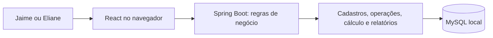

# Arquitetura e registro de decisões

## Base confirmada e propostas

**Confirmado:** MySQL, Spring Boot, Java 21+, Flyway, MockMvc, React/Vite/TypeScript e um repositório único. Sem H2 nesta etapa: testes de domínio sem banco e integração de persistência com MySQL/Testcontainers. Docker está disponível; o MySQL já instalado será usado no desenvolvimento. Login mockado por serviço no frontend. Autenticação real será responsabilidade de um backend externo; o backend de negócio não controla usuários ou sessões. A estrutura interna do backend será discutida antes da próxima expansão.

**Build confirmado em 01/11/2026:** Gradle com wrapper, por preferência de Jaime, substituindo a proposta anterior de Maven. Usar Groovy DSL (`build.gradle` e `settings.gradle`) como padrão inicial; isso não altera a linguagem Java do backend.

**Propostas para revisão:** Java 21 como baseline; Spring MVC e Spring Data JPA; monólito organizado por funcionalidade; empacotamento do frontend estático no backend para uso local. Versões exatas de Spring Boot, Gradle, Node, React, Vite, driver e Flyway serão fixadas juntas no marco 1, após verificar compatibilidade e a versão do MySQL instalado.

Baseline efetivamente usada e tarefas de comprovação: [marco 1 detalhado](05-marco-1.md). A estrutura Spring Boot/Gradle e React já passou por testes e build locais. A CI remota ainda não foi executada.

## Estrutura alvo

```text
mvp-invest/
  backend/       API de negócio, domínio, persistência e migrations
  frontend/      React, TypeScript e Vite
  docs/          Escopo, arquitetura, entregas e validação
  prototype/     Código e imagens da referência aprovada
```

Esta estrutura já foi criada no marco 1. O protótipo segue executável, com seus testes e imagens em `prototype/`.



## Decisões arquiteturais

| ID e estado | Escolha e motivo | Consequência |
| --- | --- | --- |
| ARQ-01 — confirmada | Monorepositório, com frontend e backend separados por diretórios. | Mudanças de uma funcionalidade podem ser revisadas juntas; builds continuam independentes. |
| ARQ-02 — proposta | Um backend modular por funcionalidade, com domínio financeiro separado de controllers e entidades de transporte. | Implantação simples e testes do cálculo sem depender de HTTP; evitar microserviços, filas e infraestrutura adicional neste estágio. |
| ARQ-03 — decisão vigente de 01/11/2026 | Autenticação em backend externo específico, a implementar depois. Hoje o serviço do frontend valida Jaime/Eliane mockados, com senha vazia. | Nenhum controle de usuários, identificação ou sessão no backend de negócio. A futura integração fica concentrada no serviço frontend. |
| ARQ-04 — confirmada | Fatos preservados, correções por substituição e cancelamento auditável. | Recalcular projeções; não corrigir saldo diretamente nem expor exclusão física de operações confirmadas. |
| ARQ-05 — confirmada em 01/11/2026 | Um motor financeiro no backend Java com BigDecimal, inclusive para as prévias; transporte decimal como strings para preservar valores no frontend. | React apresenta os resultados do backend e não mantém um segundo motor financeiro. Política de precisão/arredondamento permanece em revisão separada. |
| ARQ-06 — proposta | Flyway como único mecanismo de alteração do schema; JPA valida o mapeamento. | Não usar atualização automática do schema pelo Hibernate; validar migrations no MySQL. |
| ARQ-07 — confirmada em 01/11/2026 | MySQL/Testcontainers para integração de persistência e domínio sem banco; não incluir H2 nesta etapa. | Docker é necessário para a suíte de integração; não manter dependência, perfil ou schema H2. Reavaliar somente se surgir uma necessidade concreta. |
| ARQ-08 — proposta | Recalcular sincronamente o histórico de um espaço na primeira versão. | Menos infraestrutura. Medir até 5.000 operações antes de introduzir processamento assíncrono ou otimizações. |
| ARQ-09 — confirmada em 01/11/2026 | Quantidade/preço/câmbio até 18 casas; BRL persistido até 8 casas e exibido com 2; HALF_EVEN e política versionada. | Não reduzir intermediários a centavos ou truncar entradas inválidas. Fronteiras de arredondamento e precisão de divisão serão especificadas e testadas antes do motor. |
| ARQ-10 — confirmada em 01/11/2026 | Gradle com wrapper no backend, por preferência de Jaime. | Versionar scripts e arquivos do wrapper; build local e CI usam a mesma distribuição. Não criar POM ou exigir Maven/Gradle global. |

## Implementação atual e próxima revisão

O backend contém somente a classe de inicialização; nenhum endpoint de negócio foi implementado. O controle de identificação foi removido. O frontend chama `entrar(login, senha)` em `services/autenticacao.ts`, sem HTTP, retornando um perfil mockado. O estado do perfil exibido existe na memória React. O serviço grava um JWT mockado sem assinatura na localStorage (`lastro.token`), com nome, role `acesso_total`, `sub` e `iat`; sair remove o token. [Responsabilidades e operação](07-acesso-local.md).

V1–V3 permanecem imutáveis; V4 remove usuários, membros e o vínculo de criador do espaço. Espaços e demais estruturas de negócio são preservados. A senha técnica do MySQL continua privada e necessária.

A organização por funcionalidades permanece uma proposta; a criação de camadas internas será discutida com Jaime antes de implementar cadastros. Não criar diretórios vazios, uma interface para cada classe ou infraestrutura por antecipação. O mock de acesso não define como regras financeiras serão implementadas.

Pontos a decidir na conversa: responsabilidades de controller e persistência, quando extrair serviço, convenções de nomes e como revisar o tamanho das mudanças. Não implementar uma reorganização adicional antes desse alinhamento.

## Execução local

- Backend/Vite restritos a loopback; MySQL sem exposição adicional. Credenciais técnicas fora do Git.
- Vite encaminha `/api` ao backend; o JAR serve o build React para uso cotidiano.
- O login usa um serviço mockado no frontend, sem sessão HTTP ou cookies. JWT sem assinatura salvo na localStorage; sair o remove. Recarregar mantém o token, mas exige entrar novamente pois não há restauração automática do perfil.
- Não há controle de usuários, autenticação ou autorização implementados no backend de negócio. O contrato com o futuro provedor externo será definido antes da integração.
- Não persistir dados financeiros em localStorage. A única persistência de acesso autorizada é o JWT mockado (`lastro.token`); não usá-lo como autorização no backend. Publicação em nuvem permanece fora do escopo.

## Domínio e contratos propostos

- Reutilizar os conceitos do modelo v1, não adotar automaticamente todas as suas tabelas. Usuário, espaço, titular, conta, ativo, operação e movimento são conceitos distintos.
- O modelo histórico OIDC não é o schema ativo. V3 remove as credenciais e V4 remove o controle de usuários. Integração com identidade externa permanece futura.
- Custo médio móvel por espaço/titular/ativo; quantidade disponível por conta. Transferência entre contas próprias preserva custo do principal. As regras detalhadas de taxas e câmbio estão em `REGRAS_DO_BACKEND.md` do modelo v1 e precisam de testes Java próprios.
- Saldo inicial exige custo conhecido no serviço. Se o banco continuar permitindo NULL para evolução futura, a API do MVP deve recusá-lo. Custo zero exige confirmação explícita da origem; BRL tem custo igual à quantidade.
- Correção/cancelamento: transação bloqueia a revisão do espaço, valida todo o histórico candidato, grava fatos/status/auditoria e publica projeções coerentes. Falha reverte tudo. Substituição preserva o desempate temporal; não alterar os valores da versão anterior.
- Datas persistidas em UTC, com data de negócio e fuso explícitos. Proposta inicial de entrada/exibição: `America/Fortaleza`, compatível com o contexto dos participantes; revisar dados históricos que tenham outro fuso. Ordenação por instante, ordem do livro e identificador.
- API REST sob `/api/v1`, com DTOs próprios, validação de entrada e erros legíveis. Famílias futuras: titulares/contas, operações/prévia/histórico/cancelamento, posições/resultados, conferências e relatórios/exportações. Contratos de cada família serão detalhados antes de seu marco, sem expor entidades JPA diretamente.
- Quantidades, preços, câmbio e dinheiro trafegam como strings decimais; IDs como strings para evitar perda de precisão no JavaScript. Datas ISO; valores formatados em pt-BR somente na apresentação.
- Listagens de operações paginadas no servidor, com filtros e ordenação determinística. Proposta: 50 linhas por página, limite 100. Totais e relatórios usam o histórico completo autorizado, nunca apenas a página carregada.
- Frontend organizado por funcionalidades e componentes reutilizáveis; CSS do protótipo como referência. Proposta: React Router, cliente HTTP central com fetch e estado local/contexto para sessão/filtros. Adicionar outras bibliotecas somente por necessidade documentada.
- A integração futura de autenticação será com um backend externo específico. Não implementar agora clientes ou contratos preventivos. WebClient/Feign só serão escolhidos diante de uma necessidade concreta de integração no backend de negócio.

### Prévia e confirmação

Decisão confirmada: a prévia do formulário usa o mesmo motor do backend empregado na confirmação. Ela não grava operação, auditoria financeira ou uma revisão do livro e não representa uma reserva de saldo.

O frontend só solicita prévia quando os campos mínimos estão válidos e após uma breve pausa na edição. Uma resposta antiga não pode substituir a prévia de dados mais recentes. Enquanto aguarda ou se houver erro, informar o estado sem apresentar um resultado antigo como atual. Na edição de um lançamento, a prévia considera a substituição da versão vigente, não uma segunda operação adicional.

Ao salvar, o backend revalida e recalcula contra a revisão atual. Se o histórico mudou desde a prévia, informar o conflito e pedir atualização dos dados antes de confirmar. Cálculos de apresentação simples não substituem nem alteram resultados do motor.

## Política decimal — base confirmada

Persistir quantidade/preço/câmbio em DECIMAL(38,18) e totais BRL em DECIMAL(38,8), conforme os limites do modelo. Usar BigDecimal desde a desserialização; rejeitar excesso de precisão e capacidade, sem truncamento silencioso.

Confirmado em 01/11/2026: usar HALF_EVEN e versionar a política, sem arredondar custos intermediários para centavos. Exibição em BRL com duas casas não altera valores internos. Entradas excedentes são recusadas; resultados calculados são arredondados apenas nas fronteiras explicitamente definidas pelo motor.

Detalhamento ainda necessário antes de implementar: precisão das divisões, pontos de quantização, tratamento do custo residual e reconciliação das parcelas arredondadas com o total. DECIMAL128 foi a proposta inicial para divisões, mas seus 34 dígitos significativos precisam ser avaliados contra a capacidade DECIMAL(38, s) do banco; não adotá-lo automaticamente como limite global. Fixtures devem cobrir divisão periódica, posição encerrada, taxas e limites numéricos. Trata-se de política gerencial, ainda sujeita à revisão independente.

## Evolução do modelo MySQL — proposta de implementação

O SQL v1 é uma referência física, não uma migration pronta para o MVP atual. Preservar o pacote original e construir migrations próprias do backend em banco/schema dedicado. Não executar o exemplo fictício no livro real.

| Etapa | Estruturas necessárias | Ajustes em relação ao modelo inicial |
| --- | --- | --- |
| Fundação de negócio | Espaços e cadastros | Preservar os dados de negócio; V4 remove controle de usuários e vínculos de acesso. Integração com identidade externa será definida depois. |
| Cadastros | Titulares, instituições, ativos e contas | Isolamento por espaço/titular; não exigir CPF/CNPJ ou cifragem de documentos para um fluxo que não utiliza esses dados. |
| Livro e cálculo | Operações, movimentos, pagamentos, auditoria, execuções e projeções | Custo inicial obrigatório para o lançamento; correções preservadas; resultados vinculados à revisão e versão do motor. |
| Conferência | Comparações de saldo | Referência textual do documento; diferença calculada, sem armazenar um selo definitivo de conferência. |
| Evolução futura | Arquivos, importações e linhas de origem | Adiar tabelas e FKs exclusivas de importação até a implementação do primeiro importador; preservar possibilidade de evolução por nova migration. |

As tabelas de operações não devem exigir tabelas de importação ausentes. A primeira versão pode registrar somente origem manual; adicionar origem CSV e seus vínculos com a funcionalidade futura. Manter atomicidade e chaves de isolamento nos vínculos entre conta, titular e espaço.

Após uma migration ser aplicada e compartilhada, corrigir por uma nova migration; não reescrever seu conteúdo para alterar um banco existente. Flyway controla o schema; não há usuários ou credenciais no schema final. Os dois perfis do mock existem somente no frontend. Validar criação em banco vazio e atualização entre versões com MySQL/Testcontainers. A quantidade final de tabelas decorrerá dos requisitos, não de uma meta de manter as 20 originais.

## Recuperação — proposta a revisar antes do marco 5

- Exportação JSON versionada do próprio espaço contém fatos e conferências, sem senhas ou sessões. Não é compatível automaticamente com o backup v3.
- Restauração por usuário no próprio espaço: validar arquivo completo, mostrar resumo e exigir confirmação da substituição; recalcular, auditar e aplicar atomicamente. IDs externos são remapeados; campos de proprietário não concedem acesso a outro espaço.
- Backup técnico do banco por procedimento local documentado; restauração testada em banco separado. Fazer backup antes de migrations e restaurações; manter cópia fora do disco principal, com proteção compatível com dados financeiros.
- Demonstrativos CSV/HTML são exportações para uso humano, não substitutos de um backup recuperável. Tratar conteúdo informado pelo usuário como texto também nesses arquivos.

## Referências oficiais consultadas

- [Spring Boot: inicialização do banco](https://docs.spring.io/spring-boot/how-to/data-initialization.html): recomenda um mecanismo único de geração do schema.
- [Spring Security: CSRF](https://docs.spring.io/spring-security/reference/servlet/exploits/csrf.html): integração com SPA e renovação de token após login/logout.
- [Spring Boot: Testcontainers](https://docs.spring.io/spring-boot/reference/testing/testcontainers.html): integração dos testes com serviços em containers.
- [H2: perguntas frequentes](https://h2database.github.io/html/faq.html): os modos de compatibilidade implementam somente parte dos recursos.
- [Vite: proxy de desenvolvimento](https://vite.dev/config/server-options): encaminhamento de chamadas ao backend.
