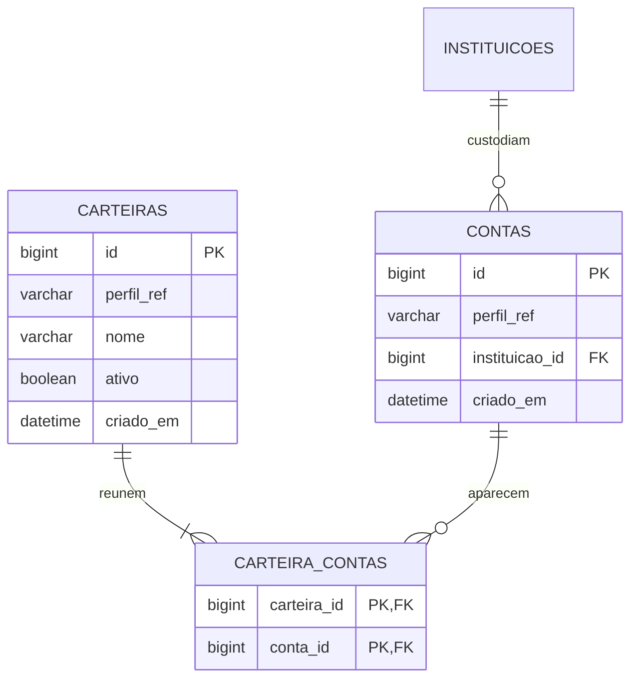

# Modelagem vigente — carteiras e contas do usuário

Decisão de Jaime em 02/11/2026. Substitui a entidade de titulares e seu cadastro. Um usuário acompanha seus próprios investimentos; carteiras são visões de contas completas, não proprietários independentes de operações.

## Relações

`perfil_ref` em carteira e conta identifica o usuário proprietário, obtido pela service por `UsuarioAtual.id()`. O provedor de identidade é externo; não existe tabela de usuários neste schema. Cada usuário tem no máximo uma conta por instituição. A instituição pertence ao catálogo compartilhado; a conta pertence ao usuário.

Uma carteira exige pelo menos uma conta na API. Uma conta pode compor várias carteiras ou permanecer sem carteira após a remoção de seus vínculos. A conta é preservada para reutilização e para o futuro histórico financeiro.

Exemplo: Jaime tem uma conta Binance e uma BitGet. A carteira Principal reúne as duas; a carteira Binance reutiliza a primeira. Eliane tem outra conta Binance, com ID próprio. Nenhuma conta ou operação é copiada ao criar uma visão.

## Regras de integridade

- Carteira: nome único por usuário, inclusive arquivada. A API limita nome normalizado a 160 caracteres e valida seleção não vazia/sem repetições.
- Conta: unicidade `(perfil_ref,instituicao_id)`, sem nome, tipo ou situação próprios. A interface identifica a conta pelo nome da instituição.
- Vínculo: PK `(carteira_id,conta_id)` e FKs sem exclusão em cascata. A service seleciona contas somente do usuário atual; o cliente fornece instituições, não IDs arbitrários de contas.
- Criar/editar carteira e atualizar contas/vínculos é atômico. Conflitos de unicidade ou bloqueio concorrente retornam 409 e permitem nova tentativa após rollback.
- Desvincular remove somente a associação. Arquivar uma carteira mantém suas contas/vínculos e não afeta outras carteiras. Carteira arquivada precisa ser reativada antes de editar.
- Novos vínculos usam instituições ativas. Vínculos existentes podem ser preservados quando a instituição for inativada.

## Origem dos dados e cálculos futuros

Operações futuras devem referenciar a conta do usuário. Vinculá-las apenas à instituição misturaria usuários; vinculá-las à carteira duplicaria fatos ao criar novas visões.

Selecionar carteiras corresponde à união de suas contas por ID. Uma conta presente em duas carteiras entra uma única vez nos totais da seleção. Alterar uma carteira muda a seleção de contas apresentada, sem copiar/mover operações ou alterar suas bases de cálculo.

A carteira não divide operações, posições ou datas de uma conta. Revisões, concorrência e regras financeiras serão especificadas na etapa do motor, considerando o usuário proprietário e as contas reais; o agrupamento de visualização não cria uma unidade de apuração independente.

## Evolução e limites

V8 requer os cadastros antigos vazios, preserva V1–V7 e o catálogo de ativos, substitui titulares e a estrutura antiga de contas e insere Binance/BitGet. Instituições são mantidas pelo sistema, sem CRUD para o usuário. País da sede não é inferido.

O mock de acesso permanece como documentado em [contexto de usuário](07-acesso-local.md). Não há publicação em nuvem, importação, integração com corretoras, motor ou relatórios nesta entrega.

[Contrato do cadastro](09-cadastro-de-carteiras.md) · [Dicionário de dados](11-dicionario-de-dados.md)
