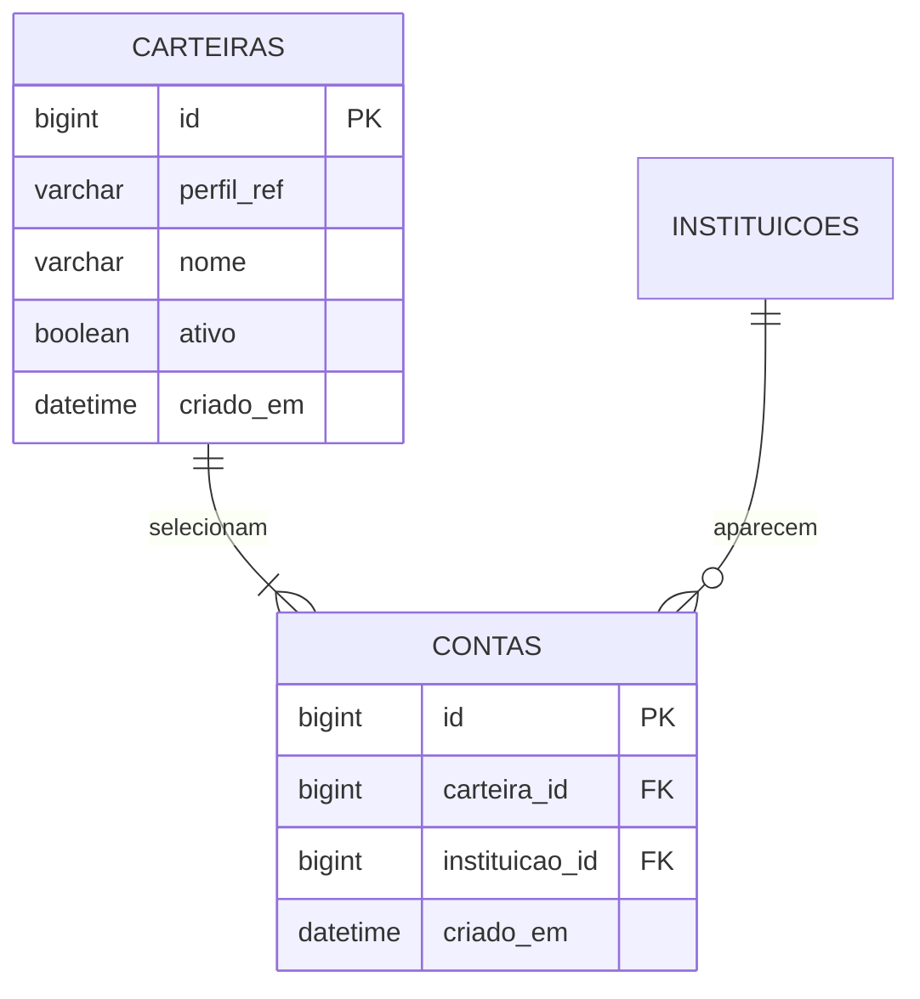

# Modelagem vigente — carteiras como visões de instituições

Esclarecimento de Jaime em 02/11/2026: carteiras que incluem Binance mostram os mesmos registros da Binance do usuário. Operações devem ser únicas. Isso substitui a interpretação anterior de históricos independentes por carteira.

## Associação entre carteira e instituição

A tabela `contas` representa a associação muitos-para-muitos entre carteiras e instituições. Cada linha é um vínculo, com ID próprio e unicidade `(carteira_id,instituicao_id)`. O mesmo ID de instituição pode aparecer em várias carteiras. Não existe outra tabela `carteira_contas`.

`carteiras.perfil_ref` vem de `UsuarioAtual.id()`. Consultas e alterações dos vínculos passam pela carteira do usuário atual; o backend não cadastra usuários. Uma carteira exige ao menos uma instituição na API.

Exemplo: Principal inclui Binance/BitGet e Reserva inclui Binance. São três linhas de associação em `contas`. As duas linhas Binance selecionam a mesma instituição e o mesmo histórico de Jaime. Seus IDs distintos identificam apenas os vínculos. A Binance de Eliane utiliza o mesmo catálogo, mas suas operações são separadas pela referência do usuário.

## Histórico financeiro futuro

- Cada operação será registrada uma única vez, identificada por seu próprio ID e vinculada ao usuário e à instituição.
- Não associar a propriedade das operações a `contas.id` ou `carteira_id`: esses IDs representam organização de visualização, que pode ser alterada.
- Várias operações podem pertencer ao mesmo usuário/instituição. Essa combinação determina o histórico; não é uma restrição que permita apenas uma operação. Idempotência de submissão/importação será detalhada no contrato do livro.
- Carteira seleciona todas as operações das instituições associadas para o usuário atual. Nova operação Binance aparece nas carteiras que selecionam Binance, sem cópia adicional.
- Selecionar várias carteiras corresponde à união das instituições daquele usuário. Cada operação entra uma única vez nos totais, mesmo quando a instituição está em várias carteiras. Preferir filtro por existência/conjunto de instituições, evitando multiplicar operações pelos vínculos.
- Remover associação ou arquivar carteira não apaga operações, bases de custo ou resultados. Reassociar a instituição permite consultar o histórico existente, sem reimportação.
- Alterar a seleção de instituições é organização de visualização; não registra transferência financeira ou movimento de custódia.
- Não misturar usuários pelo catálogo compartilhado: filtrar sempre a referência do usuário, obtida do contexto, além da instituição. Regras de cálculo seguem o usuário/ativo, sem criar custo médio independente por carteira.

Operações e consultas financeiras ainda não existem nesta etapa. A estrutura atual de carteiras/instituições já representa os vínculos; o contrato de persistência do livro deverá aplicar as regras acima.

## Cadastro e edição atuais

Nome obrigatório, normalizado nas extremidades, até 160 caracteres e único por usuário, inclusive arquivadas. Instituição única dentro da carteira. Edição mantém IDs dos vínculos preservados, cria os novos e remove os retirados somente daquela carteira. Remover e adicionar novamente pode gerar outro ID de vínculo, sem definir um novo histórico financeiro.

Arquivar/reativar preserva vínculos; arquivada precisa ser reativada antes de editar. Novas associações exigem instituições ativas; existentes podem ser mantidas/removidas após inativação. Gravações são transacionais; falhas não deixam dados parciais.

JPA mantém a associação como entidade explícita: `Carteira` tem `@OneToMany` de `Conta` e esta referencia carteira/instituição. Persistência/merge e remoção de órfãs afetam as linhas de vínculo; `@EntityGraph` carrega os dados dos DTOs. Não adicionar cascade de exclusão de operações aos vínculos.

## Evolução

V8 corrigida e reaplicada localmente na etapa anterior por autorização explícita de limpeza após backup. Este esclarecimento altera a documentação do significado e do livro futuro; não requer refazer vínculos ou limpar o banco. V1–V8 aplicadas permanecem preservadas; evoluções futuras usam nova migration.

[Contrato](09-cadastro-de-carteiras.md) · [Dicionário](11-dicionario-de-dados.md) · [Retomada](06-retomada.md)
