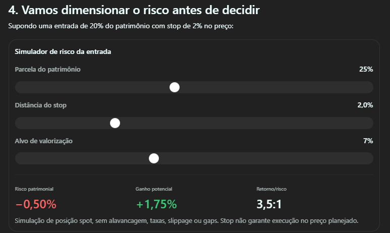

# Simulador de risco da operação

Ideia registrada por Jaime em 02/11/2026. Estado: para avaliar após o produto estar pronto e ser oportuno buscar novas funcionalidades. Não integra o escopo atual do MVP.

## Oportunidade

Ajudar o usuário a avaliar o risco de uma operação acompanhada pelo sistema, explorando hipóteses com controles ajustáveis e observando seu efeito sobre o patrimônio e a relação entre retorno e risco.

## Referência visual

Imagem fornecida por Jaime como inspiração. Os valores ilustrativos não são recomendações nem regras aprovadas do produto.

A referência apresenta controles para parcela do patrimônio, distância do stop e alvo de valorização, com saídas de risco patrimonial, ganho potencial e relação retorno/risco. Ela descreve uma simulação spot sem alavancagem, taxas, slippage ou gaps e observa que stop não garante execução no preço planejado.

## Pontos para avaliar quando a ideia for retomada

- Quais decisões o simulador deve ajudar a tomar e quais operações serão contempladas.
- Qual patrimônio servirá de base e como aproveitar os dados existentes sem duplicar registros.
- Quais hipóteses, custos e limitações precisam ficar explícitos para interpretar a simulação.
- Se a primeira versão será uma simulação independente ou vinculada a uma operação acompanhada.

Esses pontos são questões futuras, sem definição de arquitetura, cálculo, integração ou execução automática de ordens nesta etapa.
