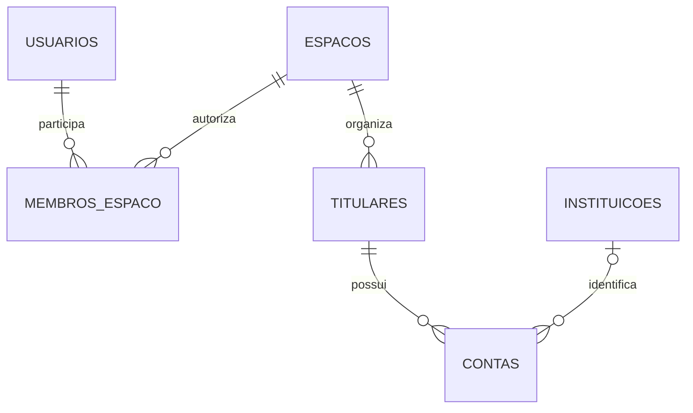
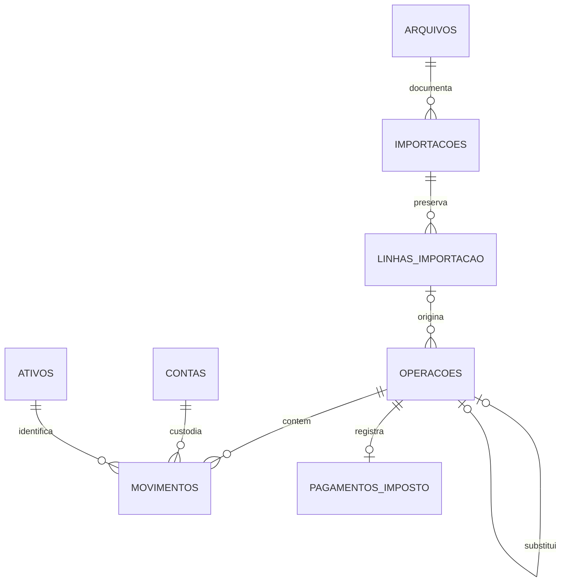
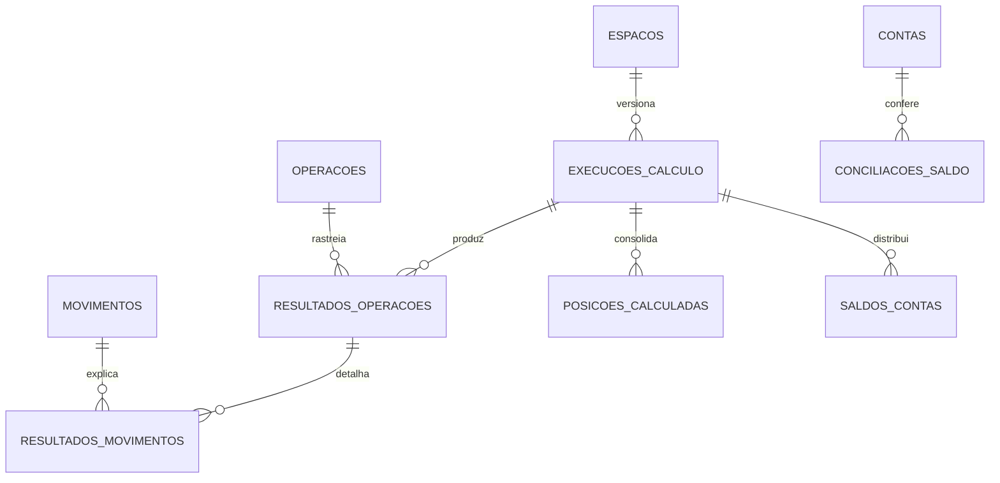

# Relacionamentos — Lastro

O SQL é a fonte do modelo físico. Estes diagramas resumem relações; os campos e FKs compostas estão no DDL e no dicionário. Todas as FKs usam RESTRICT.

## Acesso e titularidade

## Operação e origem

O mínimo de pernas e sua combinação são validados pelo backend ao confirmar. Operação manual não tem linha de importação; imposto externo não tem movimento de carteira. Os documentos de imposto e conciliação também podem apontar para `arquivos`.

## Projeções e conferência

`conciliacoes_saldo` guarda o valor informado do extrato. Diferença e situação são calculadas contra um snapshot da mesma data e revisão, sem FK para um resultado antigo congelado. A auditoria do espaço registra alterações; não é mostrada como FK polimórfica para cada entidade.

## Caminho da informação

**Operação original → movimentos → execução versionada → resultado/posição → relatório e conferência.**

A interface pode continuar simples. A estrutura interna guarda o detalhe necessário para entender resultados e organizar os dados fiscais sem recadastro mensal.
